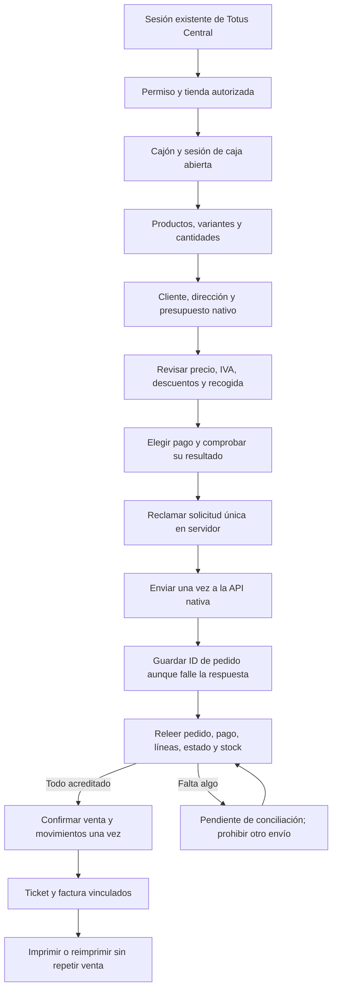

# TotusTPV: estudio de POSTPV y recorridos del módulo propio

Fecha: 15/11/2026. Referencia de Totus Central: `59ddb6415dba9c8609011650d53ebeefe592faf1`.

## Decisión de producto

**TotusTPV es un módulo de Totus Central. POSTPV sirve exclusivamente como referencia funcional y visual y deberá poder desinstalarse.**

No crear otra aplicación, otro acceso de operador, otro proyecto Supabase ni otra definición de tiendas/cajas. No usar tablas `posp_*`, clases o controladores de `tpvtienda`, sus recursos Webservice, licencia, ionCube ni su instalación para ejecutar el módulo propio. El prototipo independiente de Totus TPV es evidencia de pruebas, no la arquitectura de destino.

La operación con POSTPV desinstalado será una condición de aceptación, no una promesa basada en que el módulo siga instalado durante las pruebas. Este estudio no desinstala módulos ni cambia configuración de tiendas.

## Qué se ha estudiado realmente

| Evidencia | Alcance y límite |
|---|---|
| Interfaz abierta en PrestaShop 8.2.8 de preproducción | Pantalla de venta, menú, listado de pedidos, ficha del pedido QA 46542 y configuración. Sin cobrar ni devolver ventas durante el estudio. |
| Configuración abierta del módulo | General, Caja, Estados y formas de pago, Ticket, Permisos, Interfaz y Devoluciones. Se consultaron etiquetas y controles; no se guardaron ajustes. No se afirma el valor de interruptores que la accesibilidad no identifica como seleccionados. |
| Resto de pestañas | Se identifican Clientes, Emails, Funciones especiales, Buscador, Pantalla extra, Códigos barras, Presupuestos, Personalización y Traducciones. Su mera presencia no acredita una prueba completa. |
| Paquete local oficial 7.6.2 | `output/postpv-preprod-20261113/tpvtienda-official-20261113.zip`, SHA-256 `3BCD356BBB0DB19D507ECA0A643124687735AD1A9208300A948841708CBF117B`. Las copias extraídas de `tpvtienda.php`, `js/tpvtienda.js` y `classes/TpvOrderCaja.php` coinciden con sus entradas del ZIP. No se certifica que todos los archivos instalados actualmente sean idénticos a ese paquete. |
| JavaScript y plantillas legibles | Se trazan llamadas y contratos visibles de venta, caja, clientes, descuentos, aparcados, devoluciones, pedidos e impresión. No se copia el código del proveedor a Totus Central. |
| PHP protegido | Los controladores de acciones, `POSPrestashop.php`, `validateOrderPOSPrestashop.php`, `InstallPOS.php` y otras clases principales usan ionCube. **No se ha leído ni descifrado su implementación interna.** El nombre de un método no demuestra su transacción o sus controles de seguridad. |
| Manuales oficiales del proveedor | Complementan funcionalidades que no se ejecutaron con operaciones comerciales. Se enlazan al final. |
| Estudio previo del 11/11 | Describe tablas y datos de Hortimatic antigua; es evidencia histórica, no una lectura nueva de esa base ni prueba de igualdad con 8.2.8. No importar sus BLOB ni deducir cajas por empleado/fecha. |

La versión antigua 1.7.8.11 se abrió inicialmente para localizar el TPV; tras la aclaración del usuario, la referencia de interfaz utilizada fue **8.2.8**. No mezclar sus configuraciones.

## 1. Pantallas y distribución observada

### Venta

- Cabecera con búsqueda por nombre/referencia, filtros, cliente, nota, avisos, aparcar y menú.
- Área de productos con imagen, nombre, precio y stock. En la vista consultada había dos productos visibles; no es una certificación del tamaño total del catálogo.
- Lista de compra y controles de producto/combinación/cantidad/descuento.
- Pie con total, impuestos, caja, descuento, transporte, forma de pago y **Finalizar**.
- Medios visibles en esa instalación: Efectivo, Tarjeta, Presupuesto, Bizum y Mixta.
- Menú: Nuevo producto, Carritos, Presupuestos, Devoluciones, Pedidos, Pagos, moneda, pantalla completa y cambio de empleado.

La pantalla vacía conserva mucho espacio de catálogo. **TotusTPV conservará la lógica de mostrador, no ese vacío ni una copia de su CSS.** Usará cabecera común, controles compactos y contenido que ajuste su altura.

### Pedidos y ficha

Se observó una tabla con filtros de ID, referencia, ticket, factura, nombre/email, estado, total y fecha. La ficha incluye cliente/direcciones, líneas, impuestos, recogida, pagos y documentos; ofrece acciones de abono, repetición, ticket y envío.

**No confundir** ID de pedido, referencia comercial, número de factura y número de ticket. El pedido QA aparecía sin ticket POSTPV propio. Abrir una ficha no debe crear un documento; «Generar ticket», repetir pedido, abonar o enviar son operaciones diferentes y no se ejecutaron.

En la ficha POSTPV del pedido QA, el selector ofrecía Bizum mientras la tabla/núcleo mostraban «Pago remoto aceptado». Es una observación de presentación/mapeo, no prueba de que el pedido cambiara a Bizum. TotusTPV debe resolver siempre el ID real de estado y mostrar «Estado sin correspondencia configurada» cuando falte un mapeo; nunca elegir silenciosamente la primera opción.

## 2. Configuración que debe existir en Totus Central

| Área | Comportamiento estudiado | Aplicación propia |
|---|---|---|
| General | IVA, moneda, aparcados, cambio temporal de nombre/precio/impuesto, empleado | Contexto de venta y permisos; cambios temporales separados de editar el catálogo de Precio/Productos. |
| Caja | Asignación por tienda o empleado, selección obligatoria, denominaciones, medios incluidos | Reutilizar tienda/cajón de Central y crear una sesión de apertura independiente. Cada movimiento conserva tienda, cajón, sesión, operador e ID de venta/pago. |
| Pago/estado | Métodos visibles, cambio en efectivo, tarjeta/datáfono, mixto, crédito | **Método de pago y estado de pedido son entidades distintas.** Resolver mapeos por conexión; ningún ID numérico global. |
| Ticket | Numeración, fuente, impuestos, empleado, referencias, regalo, imprimir al terminar | Documento propio y referencia a factura nativa cuando corresponda. Reimprimir conserva número e identidad, no emite otra venta. |
| Permisos | Empleados permitidos y restricciones operativas | Usar usuarios/roles de Central y autorización en servidor por acción y tienda. No aceptar `id_employee` enviado por el navegador como identidad autenticada. |
| Interfaz | 50/50, zoom 100 %, tamaño Normal, nombre ascendente, últimos artículos primero; controles de stock/IVA | Respetar apariencia guardada de Central; vista adaptable de catálogo y ticket. Las preferencias no cambian permisos ni datos fiscales. |
| Devoluciones | Parciales, abono, medio original, vales, plazos | Flujo específico ligado a la línea original y al reembolso. Reponer stock solo si corresponde; defectuoso y vendible se distinguen. |
| Clientes | Cliente básico, selección/alta, datos de factura | Reutilizar directorio por tienda. Venta anónima explícita; no inventar datos personales o correos para una venta real. |
| Buscador | Nombre/referencia, EAN/UPC y variantes según código/manual | Buscar en servidor/páginas con debounce y cancelación de respuestas obsoletas; no cargar todo el catálogo para poder cobrar. |
| Presupuestos/crédito | PDF o presupuesto guardado; pago inicial y saldo | Mantener presupuesto, reserva, pedido y cobro separados. El soporte de cada operación depende de la API nativa disponible. |
| Pantalla extra/etiquetas | Visualización para cliente e impresión | Funciones opcionales, sin compartir tokens ni datos completos de clientes y sin bloquear una venta ya registrada por fallo de impresora. |

Mapeo observado en esta configuración: Efectivo 28, Tarjeta 29, Presupuesto 30, Bizum 23, Mixta 31. **Son ejemplos de esa tienda, no constantes a llevar al código.** Existen varios estados con nombres repetidos; el texto no identifica un estado de forma única.

## 3. Qué hace el código legible y qué no podemos afirmar

Referencias relativas al paquete oficial, no dependencias a incorporar:

| Archivo / zona | Contrato visible |
|---|---|
| `js/tpvtienda.js:177`, `pago()` | POST `checkout`: carrito, tienda, empleado, cliente, moneda/idioma, transportista, método, importe aportado, pagos mixtos, caja, notas y datos de presupuesto/crédito. |
| `js/tpvtienda.js:473`, `comprobarPago()` / `validaconPago()` | Validaciones visibles, transporte/método no vacío y ventanas distintas para efectivo, tarjeta/datáfono, mixto y crédito. Las validaciones del navegador no sustituyen al servidor. |
| `js/tpvtienda.js:1516`, `addCart` | Producto, atributo y cantidad se envían junto al contexto. La respuesta refresca compra y totales. |
| `js/tpvtienda.js:1319`, aparcar | Guarda carrito con nombre y cambia a un carrito nuevo; recuperar conserva el carrito elegido. No es un pedido cobrado. |
| `js/tpvtienda.js:2428`, devolución | Envía pedido/líneas/cantidades, caja, método de reembolso, motivo y defectuoso. No permite inferir cómo se valida internamente el límite devuelto. |
| `js/tpvtiendaCaja.js:359–409` | Separa efectivo y otros medios al preparar cierre; el conteo de efectivo no equivale al total de todas las ventas. |
| `js/tpvtiendaCaja.js:565` | Apertura con importe inicial y contexto; cerrar/transferir son operaciones específicas, no editar un número de resumen. |
| `js/tpvtiendaTicket.js:553` | Representa ticket y datos de respuesta. Renderizar un recibo no prueba que pedido/pago/stock se hayan persistido correctamente. |
| `tpvtienda.php:186` | Registra recursos Webservice propios para devoluciones/cajas/enlace pedido-caja. **TotusTPV no los utilizará.** |
| `tpvtienda.php:230/280` | Incluye hooks de presupuestos, estados y movimientos. Su efecto depende de instalación y clases protegidas. La configuración propia no debe depender de esos hooks. |

No se ha demostrado una transacción atómica del proveedor, su idempotencia interna ni la atribución de stock solamente por estas llamadas. El futuro módulo debe imponer sus propias garantías. No reproducir sus escrituras por GET, flags de identidad o reintentos de checkout como diseño de seguridad.

## 4. Recorrido completo de una venta de TotusTPV

1. Entrar en Totus Central con su sesión habitual; comprobar rol y tienda en servidor.
2. Seleccionar tienda/cajón disponibles; si no hay sesión, ofrecer apertura con fondo inicial. No elegir por nombre de empleado o última tienda usada sin confirmación visual.
3. Buscar producto o escanear. Mostrar referencia, variante, precio aplicable y disponibilidad. Un EAN ambiguo pide selección; nunca añade un producto arbitrario.
4. Elegir combinación y unidades. El primer alcance del contrato ejecutable usa unidades enteras; granel requiere su contrato decimal y prueba nativa antes de activarse.
5. Elegir cliente básico o cliente existente de esa tienda. Factura nominativa exige sus datos válidos. No crear una cuenta web o newsletter por cobrar en caja.
6. Cotizar en servidor para ese cliente, dirección, grupo, moneda y tienda. Los descuentos temporales se reflejan en el documento de venta, no cambian el PVP general. No modificar portes ni marcar IVA cero por una etiqueta de pantalla.
7. Confirmar recogida/transportista y total completo. Si la API cambia el transportista, impuestos o total, detener y pedir revisión; no cobrar la cifra antigua.
8. Para efectivo, registrar importe aplicado y recibido, devolver cambio. Para tarjeta/Bizum, resultado del proveedor o registro manual autorizado y explícito; un campo de texto o una redirección no acredita cobro. Mixto conserva cada parte, no una sola etiqueta «Mixta».
9. Crear solicitud única durable ligada a tenant/tienda/cajón/sesión/usuario, versión de carrito, cotización y pagos. Reclamo atómico y unicidad antes de cualquier efecto externo. La máquina de estados en memoria no sustituye esto.
10. Enviar una sola vez. Persistir el ID remoto tan pronto se conozca, incluso si hay timeout o error posterior. Mantener la misma solicitud al recuperar.
11. Releer pedido/estado/líneas/moneda/portes y pagos persistidos. Una venta pagada no se confirma como pendiente ni un pago pendiente como cobrado. Verificar stock con evidencia atribuible; cambios concurrentes ambiguos requieren conciliación.
12. Confirmar registro propio y movimientos de cada pago una vez; la caja no puede contabilizar a la vez la venta y su conciliación como dos cobros.
13. Relacionar ticket, pedido y factura con IDs distintos. Si falla impresión/correo, conservar venta y ofrecer reintento del documento, no del checkout.
14. Dejar carrito nuevo y conservar acceso al resultado anterior, incluido el pendiente, sin perder su identificador.

## 5. Recorridos complementarios

| Recorrido | Pasos y controles obligatorios |
|---|---|
| Efectivo | Total vigente → recibido → cambio → pedido/pago → movimiento neto de efectivo → recibo. 8,01 € con 10 € recibidos suma **8,01 €** a caja, no 10 €. |
| Tarjeta / Bizum | Seleccionar medio → confirmar o esperar proveedor → asociar referencia de cobro sin PAN/CVV → verificar resultado → pedido → conciliación. Si solo hay registro manual, debe decirlo claramente. No aumenta efectivo físico. |
| Mixto | Separar importes y medios → suma exacta → evidencias de cada parte → un pedido → movimientos separados. Cambio únicamente de la parte en efectivo. Un fallo parcial no vuelve a cobrar las partes ya completadas. |
| Crédito / reserva | Elegir cliente → depósito/fecha/saldo → registro no totalmente pagado → pagos posteriores vinculados → cierre cuando proceda. Bloquear si la API nativa disponible solo crea pedidos pagados; no usar un estado pagado para sortearlo. |
| Aparcar / recuperar | Guardar borrador con contexto y propietario → volver a lista → recuperar versión → recotizar antes de cobrar. No crear pedido, ingreso ni ticket fiscal al aparcar. |
| Descuento | Línea o conjunto → importe/% y base definidos → permiso/límite → cotización nativa nueva → total revisado. No rebajar dos veces ni cambiar coste/PVP general por una excepción del ticket. |
| Presupuesto | Borrador/PDF no cobrado → aceptación → recotización → pedido nuevo relacionado una vez. PDF, presupuesto guardado y factura son documentos diferentes. |
| Devolución parcial | Buscar pedido/línea original → cantidad aún retornable → motivo/estado físico → medio de devolución → abono/vale cuando corresponda → stock vendible o defectuoso → movimiento inverso → relectura. No exceder vendido menos devuelto ni sustituir reembolso por borrar el pedido. |
| Entrada/salida/traspaso | Sesión abierta → concepto e importe → permiso → movimiento inmutable. Un traspaso conserva origen y destino ligados; no es un ingreso de ventas. |
| Cierre | Fondo + efectivo neto + entradas − salidas − reembolsos ± traspasos → efectivo esperado → conteo → diferencia/motivo → cierre autorizado → resumen por medio → vínculo con Cajas de Central sin duplicar ingresos. |
| Ticket/factura | Venta acreditada → seleccionar documento correspondiente → número/serie → guardar relación → imprimir. Reimpresión usa el documento existente; no repetir checkout, pagos ni numeración. |
| Error / desconexión | Mostrar número remoto si existe → bloquear otro envío → conservar solicitud → releer desde servidor → conciliar. Nunca pedir al operador «prueba otra vez» sin conocer si ya hubo pedido o cobro. |

## 6. Encaje exacto en Totus Central

| Pieza existente | Uso de TotusTPV |
|---|---|
| `src/config.js`, `src/module-navigation.js`, `src/navigation-preferences.js` | Registrar en la fase operativa el módulo interno `totustpv`, etiqueta TotusTPV y ruta limpia `/tpv`, bajo Comercio. No registrar ahora un botón de cobro vacío. |
| `src/api.js`, `src/state.js`, `src/permissions.js` | Misma sesión y usuario. Ampliación explícita de permisos de servidor por tienda y acciones de cobrar, devolver, descontar, abrir/cerrar y conciliar. El permiso de ver no permite cobrar. |
| `src/components.js`, `src/column-settings.js`, `src/productos-controls.js` | Cabeceras, botones, diálogos, buscadores, tablas y configuración de columnas comunes. Persistencia por cuenta/contexto y sin otro panel de columnas. |
| `src/productos-ui.js`, `src/productos-core.js`, `src/catalog-price-batch.js` | Reutilizar lectura normalizada y acceso a ficha. Los lotes de precio/ofertas siguen en Precio; en TPV solo excepción autorizada de la venta. |
| `src/prestashop-readonly.js`, registro de conexiones y servicio `totus-connections` | Identidad real de conexión, tienda remota y capacidades. Las claves permanecen en servidor. Ampliar operaciones solo tras contrastar el servicio activo y la API oficial; no introducir puente instalado en PrestaShop. |
| `src/cash-closing.js`, Cajas | Misma definición de tienda/cajón; sesiones operativas y conciliación documentada con cierre. No otra caja paralela por nombre. |
| Clientes, Ventas, Facturación, Documentos | Consultar/editar en sus módulos; conservar referencias entre entidades. Evitar duplicación de clientes, facturas e ingresos por tener dos pantallas. |
| `src/totustpv/model.js` | **Base implementada ahora**: reglas propias de pagos, efectivo, estados, verificación y límites de devolución. No importa POSTPV ni inicia red/DB. No es un checkout activo ni una frontera de autorización. |

Proyecto de destino: el de **Totus Central** y su estructura existente. No mover a producción las tablas de pruebas, Auth o credenciales del proyecto del prototipo independiente como si fueran el módulo final.

### Persistencia a diseñar antes de migrar

Entidades propias necesarias: ventas/solicitudes, líneas con cotización congelada, asignaciones de pago, sesiones y movimientos de cajón, devoluciones, documentos y diario de conciliación/salida. Deben incluir negocio/tenant, conexión, tienda, cajón/sesión y actor de Central; referencias remotas siempre junto a la conexión.

Reutilizar los identificadores reales de `stores` y `drawers` después de inspeccionar el esquema; no inventar tipos ni duplicar tablas de maestros. Índices únicos por solicitud y pedido remoto/conexión; escrituras y permisos atómicos; registros financieros auditables y correcciones relacionadas, no borrado silencioso. Las migraciones, RLS y ampliación del servicio **no se han aplicado en este estudio**.

### Diseño visual común

Una cabecera de módulo con tienda, cajón y sesión visibles. Pestañas comunes: Venta, Operaciones, Devoluciones y Caja; configuración desde los permisos habituales. Catálogo y ticket en dos zonas ajustables en escritorio, sin un marco doble ni alturas mínimas que rellenen media pantalla. En móvil, catálogo/ticket alternan sin perder el total y la acción contextual; tipografía, márgenes y controles se adaptan, no solo el contenedor. Tablas con desplazamiento horizontal cuando haga falta, sin romper palabras de botones en columnas estrechas.

Usar el mismo selector de columnas, búsqueda y escala de botones que Central. Un único acceso por acción/contexto; no duplicar paginadores ni botones temporales de cargar páginas. El contraste y los estilos personales deben seguir funcionando.

## 7. Sustitución y aceptación sin POSTPV

1. Inventariar funciones usadas y configuración por tienda; conservar solo información legible y exportaciones autorizadas. Un respaldo no equivale a un importador probado.
2. Preparar datos maestros en Central y verificar capacidades nativas. No importar BLOB cifrados como si fueran movimientos ni reconstruir cajas por solape de horarios.
3. Probar alta, lectura y recuperación de un pedido propio, con pago/estado/portes/stock correctos **sin reparación manual**. La prueba recuperada 46542 no cumple este criterio de automatismo.
4. Probar los recorridos aplicables de la matriz adjunta en preproducción con datos de prueba; separar resultados de código, simulación y pruebas nativas reales.
5. En una ventana autorizada, probar con POSTPV desinstalado y sin sus recursos/tablas disponibles. No basta con ocultarlo del menú. Comprobar que tampoco queda un hook/override del que dependa la operación.
6. Realizar un corte por tienda/cajón: no dos TPV cobrando la misma sesión. Exportación de históricos con procedencia y conciliación; conservar archivo consultable, no mantener la instalación como dependencia oculta.
7. Solo después habilitar usuarios reales, impresora y medios verificados. Probar que el cliente puede configurar, operar, recuperar y cerrar sin IA, consola, SQL ni acceso al administrador de PrestaShop.

No se ha desinstalado POSTPV en esta intervención ni se han creado ventas/abonos/cierres para este estudio. No se declara soportada una operación que la API instalada no permita.

## 8. Estado de esta entrega y lo pendiente

Hecho: estudio de las pantallas/configuración indicadas, contraste de código visible y manuales; recorridos y decisiones de integración; modelo propio en `src/totustpv/` con pruebas de importes, aislamiento, no repetición, relectura y devolución; matriz de aceptación.

Pendiente de la fase de construcción: pantalla operativa integrada, almacenamiento/RLS y diario durable, adaptador nativo probado sin POSTPV, pagos reales, documentos e impresión, devoluciones, cierres, instalación autónoma y corte de sustitución. No se ha publicado un módulo de venta comercial ni trasladado el problema actual a un botón decorativo.

Incidente previo que debe quedar resuelto antes de abrir ventas: el pedido QA 46542 se creó por 8,01 €, pero necesitó recuperar manualmente su estado. Después se releyó correctamente pago/estado/stock, con stock 5→4 y conexión cerrada. Eso demuestra una conciliación del pedido recuperado, **no** un checkout automático completo ni una causa interna ya diagnosticada.

## Fuentes

- Código del paquete oficial local descrito arriba; no se incorpora al repositorio ni se publican el ZIP, SQL de configuración, licencias o tokens.
- [Manual oficial de POSTPV](https://www.pos-tpv.com/es/manual/manuales-tpv-prestashop).
- [Cajas y arqueos](https://www.pos-tpv.com/es/manual/manuales-tpv-prestashop/cajas-en-pos-tpv-prestashop).
- [Pago mixto](https://www.pos-tpv.com/es/manual/manuales-tpv-prestashop/pago-mixto-pos-tpv-prestashop).
- [Devoluciones](https://www.pos-tpv.com/es/manual/manuales-tpv-prestashop/devoluciones-pos-tpv-prestashop).
- [Descuentos](https://www.pos-tpv.com/es/manual/manuales-tpv-prestashop/como-anadir-descuentos-pos-tpv-prestashop).
- [Crédito y reservas](https://www.pos-tpv.com/es/manual/manuales-tpv-prestashop/pago-a-credito-o-reservas-pos-tpv-prestashop).
- [Presupuestos](https://www.pos-tpv.com/es/manual/manuales-tpv-prestashop/presupuestos-pos-tpv-prestashop).
- [Búsqueda y lector](https://www.pos-tpv.com/es/manual/manuales-tpv-prestashop/anadir-productos-a-la-lista-y-usar-el-lector-de-codigo-de-barras-pos-tpv-prestashop).
- [Clientes](https://www.pos-tpv.com/es/manual/manuales-tpv-prestashop/crear-y-gestionar-clientes-pos-tpv-prestashop).
- [Datáfono](https://www.pos-tpv.com/es/manual/manuales-tpv-prestashop/configurar-datafono-o-lector-de-tarjetas-en-pos-tpv-prestashop).
- Core nativo estudiado: [Order::addWs y setCurrentState](https://github.com/PrestaShop/PrestaShop/blob/8.2.0/classes/order/Order.php), [PaymentModule::validateOrder](https://github.com/PrestaShop/PrestaShop/blob/8.2.0/classes/PaymentModule.php), [OrderHistory](https://github.com/PrestaShop/PrestaShop/blob/8.2.0/classes/order/OrderHistory.php). Estas referencias de 8.2.0 orientan el contrato de la rama 8.2; no sustituyen el contraste de los archivos/overrides instalados en 8.2.8.
