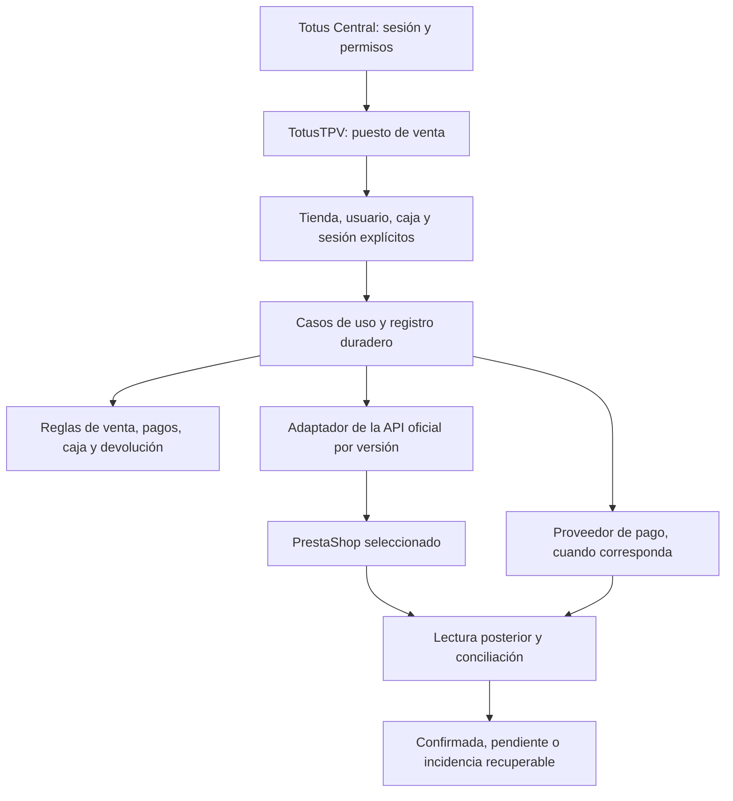

# TotusTPV: memoria del trabajo y arquitectura de integración

Fecha: 15 de noviembre de 2026. Documento principal del futuro módulo de Totus Central.

## 1. Objetivo y estado real

El objetivo es trabajar desde Totus Central: vender en mostrador, gestionar clientes, pagos, existencias y cajas, y registrar los pedidos en el PrestaShop seleccionado. TotusTPV forma parte de Central, con implementación propia y sin dependencia de otro TPV instalado.

No existe todavía un módulo comercial completo. Hay una prueba de conexión y pedido en preproducción, reglas y aplicación propias, un recorrido de práctica y pruebas nativas locales de pagos, pedidos, factura y abonos. La prueba remota anterior necesitó una recuperación manual; las nuevas pruebas nativas locales no acreditan por sí solas la integración HTTP desplegada. El estado preciso está en [Estado de implementación](TOTUSTPV_ESTADO_IMPLEMENTACION.md). La decisión actual sobre capacidades nativas y sus límites está en [Decisión técnica](TOTUSTPV_LIMITES_API_Y_DECISION.md).

Documentos complementarios:

- [Estudio histórico y recorridos](TOTUSTPV_ESTUDIO_Y_RECORRIDOS_20261115.md): referencia histórica de interfaz, configuración y manuales.
- [Alcance funcional integrado](TOTUSTPV_ALCANCE_INTEGRADO.md): cobertura y aceptación por función.
- `src/totustpv/model.js`: reglas originales de pagos, caja, estados y verificación.
- `tests/totustpv-model-qa.mjs`: pruebas locales de esas reglas; no son una prueba real de cobro.

## 2. Trabajo realizado desde la conexión

### 2.1 Conexión y diagnóstico

Se trabajó con un prototipo local independiente en `http://127.0.0.1:8766/` y una conexión de pruebas de Hortimatic. Ese prototipo permitió diagnosticar la comunicación; no es la estructura definitiva de Central.

Se comprobó que la API permitía consultar pedidos y anunciaba permiso POST de creación. Anunciar POST no acredita que el proceso comercial termine correctamente. La clave y los tokens no forman parte de esta documentación.

El diagnóstico encontró el carrito QA 70814 sin pedido asociado. Se corrigió la interpretación de respuestas vacías y se preparó una comprobación previa sin crear un pedido. Se mantuvo bloqueado el envío hasta recibir autorización para una única prueba.

### 2.2 Preparación de la prueba

La preparación correspondió a Hortimatic en preproducción, carrito 70814, importe 8,01 €, una unidad, recogida sin portes y efectivo simulado. El stock observado antes de la prueba era 5 unidades. Se autorizó una única venta persistente; no hubo cobro bancario real.

La preparación debía mostrar contexto, artículos, importe y efecto esperado antes de enviar. Esa separación entre preparar y confirmar se conserva como requisito del módulo integrado.

### 2.3 Creación y resultado parcial

Se creó el pedido nativo 46542. Sin embargo, la comprobación posterior detectó que el estado no había quedado correctamente finalizado. Se conservó el identificador remoto y la operación quedó incierta, evitando reenviar el pedido a ciegas.

En PrestaShop se comprobó un pago de 8,01 € y stock 4. Esa combinación demostraba que repetir la creación podía duplicar efectos ya producidos. La existencia del pedido y del pago no bastaba para dar por terminado todo el proceso.

Se reforzó la conservación del identificador de pedido, la fase del proceso y el error original. La recuperación se orientó a consultar el pedido existente, no a crear otro.

### 2.4 Recuperación autorizada

Con autorización expresa se recuperó manualmente el estado «Pago remoto aceptado» del pedido existente. Después de recargar se verificaron estado 11, un único pago de 8,01 €, stock 4 y una factura, FA046485. No se creó un segundo pedido ni un segundo pago.

El historial del prototipo volvió a consultar los datos nativos y reconcilió el registro local con el pedido existente. Esta recuperación acredita que se pudo reconocer un resultado remoto ya producido. **No demuestra que esté resuelta la causa del estado incompleto durante la creación.** Esa causa sigue siendo un bloqueo para habilitar ventas ordinarias autónomas.

Los números de estado, cliente, carrito y pedido de esta prueba son datos locales de esa instalación. No se convierten en constantes del futuro producto.

### 2.5 Estudio de POSTPV

Se examinó la interfaz abierta por el usuario en PrestaShop 8.2.8: venta, menú, pedidos, ficha y configuración. Se observaron caja, formas de pago, ticket, permisos, interfaz y devoluciones. No se guardaron configuraciones ni se ejecutaron devoluciones o nuevas ventas durante ese estudio.

Se contrastó un paquete oficial local 7.6.2. Se estudiaron JavaScript y plantillas legibles para trazar venta, pago mixto, crédito, aparcados, cambios de precio, caja, devoluciones y documentos. Parte sustancial del PHP está protegida con ionCube: no se ha descifrado ni se afirma haber validado sus transacciones internas.

También se consultaron la web y los manuales oficiales de POS TPV. La versión del paquete, la instalación observada y los datos históricos de una tienda antigua son evidencias distintas. No se supone que sean idénticos.

### 2.6 Base propia incorporada al repositorio de Central

Se preparó una rama de trabajo desde la referencia publicada de Central `59ddb6415dba9c8609011650d53ebeefe592faf1`. La base nueva vive en `src/totustpv/` dentro de ese repositorio, sin otro acceso de operador ni dependencia de POSTPV.

Las reglas actuales calculan pagos en céntimos, cambio, saldo pendiente, efectivo físico por sesión y cantidades máximas de devolución. Definen estados de venta y rechazan confirmar una operación sin evidencia de lectura posterior. Incluyen comprobaciones de tienda, carrito, líneas, moneda, importes, pago, estado y stock.

Son funciones puras: no implementan todavía autorización de servidor, almacenamiento duradero, transacciones distribuidas, un proveedor de cobro ni el adaptador definitivo de PrestaShop. La condición de stock implementada corresponde a una observación aislada; no sustituye una atribución de movimientos en ventas concurrentes.

## 3. Estructura de destino

La interfaz solicita operaciones; el servidor autoriza y coordina; el dominio calcula y valida; el adaptador traduce las capacidades de cada instalación. Ninguna pantalla llama directamente a una base de datos de PrestaShop ni contiene claves privadas.

La organización de código propuesta es:

| Capa | Responsabilidad |
|---|---|
| Interfaz Central | Ruta `/tpv`, componentes comunes, contexto visible y formularios compactos |
| Casos de uso | Preparar venta, confirmar, conciliar, devolver, reponer, abrir/cerrar caja |
| Dominio | Importes, impuestos, estados, límites, asignación de pagos y efectivo |
| Persistencia | Operaciones duraderas, referencias remotas, auditoría y conflictos |
| Adaptadores | API oficial de cada PrestaShop y proveedor de pago autorizado |
| Documentos y puesto | Impresión, ticket, cajón y pantalla de cliente sin repetir cobros |

Los nombres de archivos futuros se elegirán conforme a la estructura existente. No crear servicios paralelos porque una pantalla necesite datos. La primera entrega de código no registra una ruta vacía ni un botón de cobro aparente.

## 4. Entidades y relaciones que no se pueden mezclar

| Entidad | Identidad y reglas |
|---|---|
| Cuenta de Central | Límite de aislamiento de datos y permisos; se valida en servidor |
| Conexión | Instalación concreta de PrestaShop y capacidades verificadas; credenciales sólo en servidor |
| Tienda | ID nativo dentro de una conexión; dos instalaciones pueden tener el mismo número de tienda |
| Usuario y operador | Usuario autenticado de Central y autorización para actuar en una tienda; atribución explícita, sin compartir sesiones |
| Puesto | Dispositivo/configuración operativa e impresora; no otorga permisos por sí solo |
| Caja | Cajón físico o caja autorizada, perteneciente a un establecimiento; distinta de un arqueo |
| Sesión de caja | Apertura y cierre concretos, responsables, efectivo inicial, movimientos y recuento |
| Cliente | Identidad y direcciones nativas por conexión/tienda; vinculación explícita si se necesita una visión común |
| Producto y combinación | Identidad nativa compuesta; stock y precio resueltos según contexto de tienda |
| Venta | Operación propia con identificador estable, carrito, contenido preparado y referencias remotas |
| Pedido | ID y referencia nativos de PrestaShop; pueden existir aunque la respuesta de creación se pierda |
| Pago | Cada asignación y evidencia de cobro, método, moneda, importe y referencia; separado del estado del pedido |
| Documento | Ticket, factura o abono con su propia identidad y relación con el pedido; reimpresión no crea otra venta |
| Movimiento de stock | Recepción, venta, ajuste o devolución con motivo, origen y resultado verificable |
| Devolución | Vinculada a la venta y líneas originales, con cantidades acumuladas y reintegro separado |

Se reutilizan las tiendas, usuarios y cajas existentes de Central. Antes de ampliar el esquema se inventarían sus relaciones actuales y consumidores. No se decide unificar o borrar registros por coincidir sus nombres.

## 5. Invariantes de integración

1. La cuenta y los permisos se obtienen de la sesión verificada, nunca de un parámetro confiado del navegador.
2. Conexión, tienda, moneda, operador y caja acompañan cada comando y cada registro; un cambio de tienda no traslada silenciosamente el carrito.
3. Importes en unidades menores enteras y reglas explícitas de redondeo; totales fiscales calculados o contrastados con la tienda antes de cobrar.
4. Cada confirmación usa una identidad de operación persistente y exclusiva. Doble clic, recarga o timeout no autorizan otro envío.
5. PrestaShop y Central no comparten una transacción atómica. Ante un resultado parcial se conserva evidencia, se concilia y se muestra una incidencia recuperable.
6. El método visible de pago no prueba que un proveedor haya cobrado. Efectivo, tarjeta, Bizum y mixtos tienen evidencias diferentes.
7. Sólo el efectivo neto afecta al cajón. Cambio, entradas, salidas y devoluciones físicas se registran por separado.
8. Un estado remoto se mapea por conexión; el número 11 de la prueba no se reutiliza universalmente.
9. Una venta se declara confirmada tras comprobar sus efectos requeridos. Factura, impresión y envío tienen estados propios y no desencadenan otro cobro al fallar.
10. Ajustar precio en una venta no modifica el catálogo. La modificación permanente y las ofertas de catálogo siguen perteneciendo a Precio.
11. Una devolución no supera las cantidades vendidas menos las ya devueltas. Producto defectuoso no repone stock automáticamente.
12. No se deduce una caja a partir del empleado y la hora; cada venta conserva su sesión de caja explícita.
13. No se leen ni escriben tablas de POSTPV para operar TotusTPV. Su retirada no puede dejar referencias ejecutables.

## 6. Recorrido de venta completo

1. Entrar con la sesión de Central y elegir una tienda autorizada.
2. Identificar puesto, operador y sesión de caja; abrirla si corresponde y existe permiso.
3. Añadir productos/combinaciones por búsqueda o lector; conservar el origen de cada precio.
4. Seleccionar cliente y direcciones válidas, o el cliente de mostrador configurado para esa tienda.
5. Aplicar cantidades, descuentos y transporte; preparar y contrastar importes e impuestos.
6. Mostrar el resumen y distribuir el importe entre métodos; calcular cambio o saldo pendiente.
7. Registrar duraderamente la operación y reclamar su ejecución exclusiva en servidor antes del efecto remoto.
8. Ejecutar el recorrido soportado por la API y, cuando proceda, el proveedor de pago. El orden concreto entre cobro y pedido requiere un diseño de recuperación específico por proveedor; no se fija una secuencia universal insegura.
9. Conservar inmediatamente identificadores y evidencias recibidos, también cuando una fase posterior falle.
10. Releer pedido, líneas, totales, estado, pagos y efectos de stock aplicables. Resolver concurrencia sin asumir que toda variación de existencias corresponde a esta venta.
11. Confirmar, dejar pendiente o pasar a conciliación con un mensaje concreto. Nunca ofrecer «repetir venta» como solución genérica de un timeout.
12. Registrar movimientos de caja una sola vez. Emitir/obtener documentos y permitir reimpresión sin repetir el proceso comercial.

Para crédito, reservas y presupuesto existen estados propios: no se marcan como venta íntegramente pagada. Para devoluciones se coordina el abono, reintegro y posible reposición, conservando cada efecto parcial.

## 7. Stock y reposición

La reposición debe estar disponible desde Central y referenciar producto, combinación y tienda correctos. Debe indicar si el operador añade unidades o establece un recuento absoluto. Son operaciones diferentes.

Una lectura antigua seguida de una escritura absoluta puede deshacer una venta concurrente. Antes de implementar se debe comprobar qué garantías ofrece la API instalada. Si no permite un incremento seguro o detectar conflictos, no se promete recepción concurrente sin riesgo: se diseña un procedimiento verificable y se explicita su límite. Un registro local no bloquea las ventas web ni otros clientes de la API.

Los traspasos entre instalaciones no son una única escritura: necesitan salida y entrada vinculadas, recepción pendiente e incidencias recuperables. La valoración de inventario, coste de compra y precios se comparte con Productos/Precio sin duplicar sus editores.

## 8. Experiencia y configuración autónoma

Central debe ofrecer un recorrido guiado: conexión existente, diagnóstico de permisos/capacidades, tienda, operadores autorizados, cajas, métodos y estados, cliente de mostrador, transporte, documentos e impresora. Cada comprobación distingue lectura de una operación que crea datos.

Los errores explican qué falta y cómo resolverlo desde la herramienta. No se exige ejecutar SQL, copiar tokens, instalar módulos puente o pedir ayuda de una IA para configurar una tienda.

La interfaz mantiene el diseño común: una cabecera, controles del mismo tamaño, tablas y configuración de columnas compartidas, búsqueda usable y preferencias persistentes. En móvil se adapta la tipografía y se alternan catálogo/carrito; no se encoge una pantalla de escritorio completa.

## 9. Plan de construcción con puertas de aceptación

| Entrega | Resultado exigido antes de continuar |
|---|---|
| Contratos y capacidades | Entidades actuales inventariadas, permisos y API por versión documentados; resolver la causa del pedido incompleto |
| Persistencia y autorización | Aislamiento de cuentas/tiendas, identidades únicas, auditoría y recuperación duradera probados en servidor |
| Venta integrada mínima | Una venta de efectivo desde Central completa pedido, pago y stock nativos sin intervención manual ni POSTPV |
| Fallos y concurrencia | Doble clic, recarga, timeout antes/después del efecto, dos puestos y venta web concurrente sin duplicar ni perder datos |
| Métodos y caja | Mixtos, pendientes, pagos posteriores, apertura, movimientos y cierre conciliados con importes físicos y no físicos |
| Clientes, stock y devolución | Altas/ediciones autorizadas, reposición segura, devoluciones parciales y defectos, reintegros y abonos verificables |
| Documentos y hardware | Numeraciones correctas, impresión/reimpresión, cajón y lector probados; fallos periféricos no alteran la venta |
| Cobertura de POSTPV | Matriz funcional completada con evidencia; dependencias opcionales y límites visibles |
| Sustitución | Pruebas completas sin POSTPV instalado en un entorno preparado, histórico preservado y retirada reversible planificada |

No se retira POSTPV de una tienda operativa como parte de redactar este documento. No se migra su histórico por proximidad de nombres ni se importan sus campos cifrados por suposición. Los pedidos nativos ya existentes permanecen en PrestaShop; caja y documentos propios requieren una estrategia separada de conservación.

## 10. Pendientes explícitos y criterio de finalización

Pendientes: interfaz real dentro de Central, persistencia y autorización efectivas, adaptación de API, causa del estado incompleto, coordinación de cobros, stock concurrente, documentos, devoluciones, hardware y alta autónoma. El modelo actual tampoco implementa venta fraccionada por peso, fidelización, almacenes avanzados ni certificaciones fiscales.

Una función se considera terminada cuando tiene recorrido de usuario, permisos de servidor, efectos remotos comprobados, recuperación de fallos, historial y evidencia de prueba. «Botón visible», «respuesta HTTP correcta» y «prueba simulada pasada» no equivalen a función comercial completa.

El objetivo de estabilidad se consigue con estos controles y evidencias. No se declara que sea imposible cualquier fallo; se exige que los fallos previsibles no pierdan ventas, dupliquen cobros o obliguen a reparaciones manuales sin trazabilidad.
